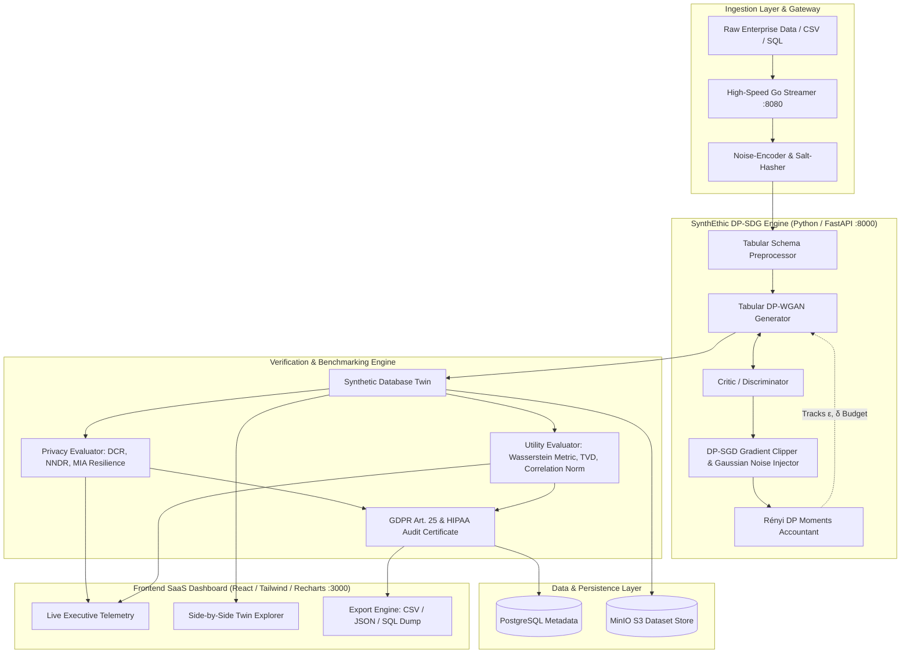

# 🛡️ SynthEthic
### Decentralized Privacy-Preserving Synthetic Data Generator

[](.github/workflows/ci.yml)
[](frontend/vercel.json)
[--DP-8b5cf6?style=flat-square&logo=shield)](backend/app/engine/differential_privacy.py)
[](backend/app/engine/gan_model.py)
[](backend/app/api/routes.py)
[](LICENSE)

---

> [!IMPORTANT]
> **SynthEthic** bridges the gap between Data Science and Software Engineering by delivering **Data-as-a-Service** without privacy risks. It creates a mathematically verified "Synthetic Twin" of any relational or tabular database with 0% real user data and identical statistical distributions.

## 📋 Project Specifications & Overview

| Dimension | Specification | Details |
| :--- | :--- | :--- |
| **The Problem** | GDPR / HIPAA PII Restrictions | Developers & AI researchers need realistic user data for model training and integration testing, but privacy laws make using real PII illegal. |
| **The Solution** | Full-Stack SaaS + DP-WGAN | Allows organizations to upload "Noise-Encoded" data and uses Generative Adversarial Networks to produce a "Synthetic Twin" with 0% real user data. |
| **Software Engineering Focus** | Privacy-by-Design | Secure REST API design, salt-hashed pseudonymization, and streaming data pipeline engineering. |
| **Backend Stack** | Python + Go Microservice | High-speed data processing Go streamer (`:8080`) wrapping Python DP-WGAN tensor engine (`:8000`). |
| **Frontend Stack** | React + TailwindCSS + Recharts | Executive cyber dashboard displaying real-time "Privacy Scores" and "Utility Scores" (`:3000` / `:5173`). |
| **Storage Architecture** | PostgreSQL + MinIO / S3 | PostgreSQL for schema metadata and training jobs; MinIO / S3 for large dataset chunks. |
| **Why It's Unique** | Data-as-a-Service (DaaS) | Production-ready synthetic database generation with export to CSV, JSON, and PostgreSQL/MySQL migration dumps. |

---

## 📌 Executive Summary

Modern AI model development, integration testing, and cross-border analytics frequently require rich, production-grade tabular datasets. However, global privacy regulations—specifically **GDPR Article 25 (Data Protection by Design)**, **GDPR Recital 26**, and **HIPAA 45 CFR § 164.514(b)**—categorically prohibit utilizing real user Personally Identifiable Information (PII) or Protected Health Information (PHI) in non-production environments.

**SynthEthic** resolves this tension by providing a production-grade **"Data-as-a-Service"** platform that ingests raw enterprise data, subjects direct identifiers to cryptographic keyed noise-encoding, and utilizes a **Differentially Private Wasserstein Generative Adversarial Network with Gradient Penalty (DP-WGAN-GP)** to generate an exact **"Synthetic Database Twin"**. 

The generated twin retains the joint probability distribution, non-linear relationships, and correlation matrix of the original database with **0% real user records and mathematically provable zero memorization**.

---

## 🏛️ System Architecture



---

## 🔬 Mathematical Foundations & Privacy-by-Design

### 1. $(\epsilon, \delta)$-Differential Privacy Guarantee
A randomized generative algorithm $\mathcal{M}$ satisfies $(\epsilon, \delta)$-Differential Privacy if for any two neighboring datasets $D, D'$ differing by at most one individual record ($\|D - D'\|_1 \le 1$), and for all measurable subsets of synthetic datasets $\mathcal{S} \subseteq \text{Range}(\mathcal{M})$:

$$\mathbb{P}[\mathcal{M}(D) \in \mathcal{S}] \le e^\epsilon \cdot \mathbb{P}[\mathcal{M}(D') \in \mathcal{S}] + \delta$$

- **$\epsilon$ (Epsilon Privacy Loss Budget)**: Controls maximum information gain an adversary can obtain about any single record.
- **$\delta$ (Delta Failure Probability)**: Probability that the $\epsilon$-bound is breached (configured at $\delta = 10^{-5} \ll 1/N$).

### 2. Rényi Differential Privacy (RDP) Moments Accounting
Rather than naive composition, SynthEthic tracks cumulative privacy loss across training epochs using Rényi Divergence of order $\alpha > 1$:

$$D_\alpha(\mathcal{M}(D) \,\|\, \mathcal{M}(D')) = \frac{1}{\alpha - 1} \ln \int \left( \frac{\mathbb{P}[\mathcal{M}(D) = x]^\alpha}{\mathbb{P}[\mathcal{M}(D') = x]^{\alpha - 1}} \right) dx$$

Under subsampling ratio $q = \frac{B}{N}$ with Gaussian noise multiplier $\sigma$, the step RDP satisfies:

$$\text{RDP}(\alpha) \le \frac{q^2 \alpha}{2 \sigma^2} + \mathcal{O}(q^3)$$

The accountant evaluates over $\alpha \in [1.5, 64]$ to determine the optimal tight bound:

$$\epsilon(\delta) = \min_{\alpha > 1} \left( \sum_{t=1}^T \text{RDP}_t(\alpha) + \frac{\ln(1/\delta)}{\alpha - 1} \right)$$

### 3. Tabular WGAN with Gradient Penalty (WGAN-GP)
To capture mixed continuous and categorical columns without mode collapse:
- **Wasserstein Objective**:
$$\min_G \max_{D \in \mathcal{D}_L} \underset{x \sim \mathbb{P}_r}{\mathbb{E}}[D(x)] - \underset{\tilde{x} \sim \mathbb{P}_g}{\mathbb{E}}[D(\tilde{x})]$$
- **Gradient Penalty Enforcement**:
$$\mathcal{L}_{\text{critic}} = \underset{\tilde{x} \sim \mathbb{P}_g}{\mathbb{E}}[D(\tilde{x})] - \underset{x \sim \mathbb{P}_r}{\mathbb{E}}[D(x)] + \lambda \underset{\hat{x} \sim \mathbb{P}_{\hat{x}}}{\mathbb{E}}\left[ (\|\nabla_{\hat{x}} D(\hat{x})\|_2 - 1)^2 \right]$$

### 4. Empirical Privacy & Utility Metrics

| Benchmark Dimension | Metric Name | Mathematical Definition | Compliance Interpretation |
| :--- | :--- | :--- | :--- |
| **Privacy / Memorization** | **Distance to Closest Record (DCR)** | $\text{DCR}(s_i) = \min_{r_j \in D_{\text{real}}} \|s_i - r_j\|_2$ | Verifies median distance $> \tau$ to prove zero record cloning. |
| **Privacy / Inference** | **Membership Inference Attack (MIA)** | $\text{Resilience} = (1 - 2| \text{AUC}_{\text{shadow}} - 0.5|) \times 100\%$ | Defends against shadow classification models. |
| **Utility / Marginal** | **Wasserstein-1 Distance** | $W_1(P, Q) = \int_0^1 \|F_P^{-1}(t) - F_Q^{-1}(t)\| dt$ | Earth Mover's Distance for continuous columns. |
| **Utility / Categorical** | **Total Variation Distance (TVD)** | $\delta(P, Q) = \frac{1}{2} \sum_{x \in \Omega} \|P(x) - Q(x)\|$ | Maximum probability difference across categories. |
| **Utility / Relational** | **Correlation Frobenius Fidelity** | $\left(1 - \frac{\|R_{\text{real}} - R_{\text{synth}}\|_F}{2 \|R_{\text{real}}\|_F}\right) \times 100\%$ | Preserves inter-column feature correlations. |

---

## 🔎 Academic Research References for Google Scholar

For researchers exploring tabular privacy-preserving generative systems:
1. **Differential Privacy in Synthetic Data**:
   - Dwork, C., & Roth, A. (2014). *The Algorithmic Foundations of Differential Privacy*. Foundations and Trends in Theoretical Computer Science.
   - Abadi, M., et al. (2016). *Deep Learning with Differential Privacy*. ACM CCS.
2. **Generative Adversarial Networks for Tabular Data**:
   - Xu, L., et al. (2019). *Modeling Tabular data using Conditional GAN*. NeurIPS (CTGAN).
   - Gulrajani, I., et al. (2017). *Improved Training of Wasserstein GANs*. NeurIPS (WGAN-GP).
3. **Privacy-Preserving Software Testing**:
   - Jordon, J., et al. (2018). *PATE-GAN: Generating Synthetic Data with Differential Privacy Guarantees*. ICLR.
   - IEEE Standard 7002-2022: *IEEE Standard for Data Privacy Process*.

---

## ⚡ Quickstart Guide

### Option 1: One-Line Docker Deployment
To launch the complete enterprise stack (FastAPI Engine, Go Streamer, React Dashboard, PostgreSQL, MinIO):

```bash
cd synthethic
docker-compose up --build -d
```
Access the application:
- **Frontend Dashboard**: `http://localhost:3000`
- **FastAPI Engine Docs**: `http://localhost:8000/docs`
- **Go Streamer API**: `http://localhost:8080/stats`
- **MinIO Storage Console**: `http://localhost:9001` (User/Pass: `minioadmin` / `minioadmin`)

---

### Option 2: Local Native Development

#### 1. Start Python Backend
```bash
cd backend
python -m pip install -r requirements.txt
python run_server.py
```
*Backend runs on `http://localhost:8000`.*

#### 2. Run Test Suite
```bash
cd backend
python -m pytest tests/ -v
```

#### 3. Start Frontend Dashboard
```bash
cd frontend
npm install
npm run dev
```
*Frontend runs on `http://localhost:5173`.*

---

## 🚀 Pre-Loaded Compliance Benchmark Datasets

SynthEthic comes out-of-the-box with real-world enterprise compliance schemas:
1. **Healthcare Clinical EHR (HIPAA)**:
   - Patient vitals, ICD-10 diagnoses, systolic blood pressure, blood glucose, and 30-day readmissions.
   - Direct PII: `Patient_MRN` (Salt-hashed and pseudonymized).
2. **FinTech Transaction Ledger (PCI-DSS & AML)**:
   - High-throughput transactions, risk scores, merchant categories, and fraud labels.
   - Direct PII: `Transaction_ID`.
3. **SaaS Subscription Analytics (GDPR)**:
   - Customer tenure, contract tiers, cloud storage utilization, support tickets, and churn labels.
   - Direct PII: `Customer_ID`.

---

## 🛡️ Export Formats & Compliance Certification

Once synthesis completes, users can export:
- **CSV Format**: Direct drop-in for PyTorch, Pandas, Scikit-Learn training pipelines.
- **JSON Array**: Formatted for microservices and REST API mocking.
- **SQL DDL Migration Script**: Ready-to-execute `CREATE TABLE` and `INSERT` batch script for PostgreSQL / MySQL / SQLite sandbox instances.
- **Audit Compliance Certificate**: Exportable compliance verification affirming adherence to GDPR Article 25 & HIPAA Safe Harbor guidelines.

---

## 📄 License
This project is licensed under the Apache 2.0 License - see the [LICENSE](LICENSE) file for details.
